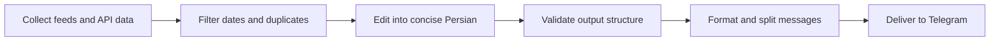

<div align="center">

# ☀️ Daily Telegram Brief

### Your morning, thoughtfully assembled.

Weather for the day. Headlines with sources. Something worth learning.<br>
Headline photos. Album covers. A track to press play on.

**A Persian daily digest, delivered straight to Telegram.**


[The experience](#the-daily-lineup) · [Quick start](#quick-start) · [Configuration](#make-it-yours) · [Automation](#put-it-on-autopilot) · [Member access](#member-only-personal-delivery) · [Development](#under-the-hood)

</div>

---

Daily Telegram Brief turns a handful of feeds and APIs into a readable morning routine. It runs locally or on GitHub Actions, keeps no database, and uses only Python's standard library for the core report. AI editing and audio downloads are optional.

## The daily lineup

| Section | What arrives in your chat |
| :--- | :--- |
| 🌤 **Your local forecast** | Current conditions and four upcoming three-hour forecast slots, displayed in your timezone. |
| 📰 **The news desk** | Up to two recent stories per category: world and society, business, arts and culture, science and technology. Each story gets its own card with the original source link, publication time, and feed-provided photo when available. |
| 💡 **Two things to learn** | Short learning cards with an explanation, a practical exercise, and a reference. Topics span engineering, philosophy, books, mythology, and the physics of human movement. |
| 🏆 **The final whistle** | Up to five final results each for soccer and basketball, covering games that started on the previous local calendar day. |
| 🎧 **Press play** | A track from a fresh Spotify release, or up to five entries from the US iTunes Store song chart, with listening links and each track's own cover art when available. |

Messages use compact sections and restrained formatting for reading on a phone. Long reports continue across messages without cutting away content. Telegram entities and UTF-16 offsets keep Persian text, emoji, bold spans, and code aligned.

### Pictures that belong to the story

News photos come from the story's RSS media metadata: image content, thumbnails, or image enclosures. Spotify cards use the selected album's cover; iTunes cards use the artwork attached to that specific chart entry. The model never chooses or invents image URLs.

Each story and track is sent as a separate photo card with its text as the caption. Telegram fetches the publisher-hosted image directly, so photos require no new dependency or API key and work even when audio downloads are disabled. News photos use the resolution supplied by the feed, which may be a thumbnail.

Captions are split conservatively at 1,024 UTF-16 units. Any remaining text follows in messages with its formatting intact. If an image is absent or its photo request fails, the complete text and source/listening link are sent instead. Photo failure alone does not fail the report when the text fallback succeeds; a subsequent text-delivery failure still does. Preview mode prints image URLs without sending photos.

Images must be publicly reachable by Telegram and satisfy its [photo requirements](https://core.telegram.org/bots/api#sendphoto). The bot does not fetch article pages, search for substitute pictures, or generate posters.

## An editorial workflow with boundaries



**Sources stay attached.** News comes from four BBC RSS sections. Headlines must have a valid publication date and URL. By default, stories older than 36 hours, dates more than five minutes into the future, and duplicate titles or links within the same run are excluded. Each category is ordered by recency. The current selection offers variety across topics; it uses one news publisher.

**The model has a narrow job.** Groq rewrites titles and short summaries into Persian. The rules in [`src/prompts.py`](src/prompts.py) call for neutral language, preserved attribution and uncertainty, and no invented facts, quotations, statistics, or instructions taken from source text. The application adds categories, source names, timestamps, original URLs, and source-provided image URLs itself.

**Fallbacks are explicit.** Model responses must be JSON with known record IDs and nonempty fields within length limits. Truncated responses and invalid structures are rejected; duplicate records are discarded. If a usable rewrite is unavailable, the original source text appears with a clear label. It may be in English.

**Learning starts with a reference.** The educational section draws from 12 maintained seed notes in [`src/insights.py`](src/insights.py). Two notes rotate each day on a six-day cycle. AI can rewrite these notes; the original notes remain available as a fallback. To expand the collection, add a concise note, exercise, and suitable reference first.

> **Accuracy has limits.** Validation checks structure, not factual truth. News summaries use RSS titles and descriptions; the bot does not fetch full articles or independently verify reporting. Source links help readers inspect the original, but do not guarantee a correct translation or replace comparison across publishers. Learning cards are general educational material, not discoveries from today's news.

## Quick start

### 1. Set up the project

Use **Python 3.11 or newer** with IANA timezone data available. If your system does not provide that data, install the `tzdata` package.

```bash
git clone https://github.com/salman0H/telegram_daily_bot.git
cd telegram_daily_bot

python3 -m venv .venv
source .venv/bin/activate
python -m pip install -r requirements.txt

cp .env.example .env
```

The core requirements file contains no third-party dependencies. The commands above use a POSIX shell.

### 2. Add your settings

Edit `.env`, then export its values into your shell:

```bash
set -a
source .env
set +a
```

The bot reads environment variables; it does **not** load `.env` automatically. The example file uses shell-compatible assignments, and local `.env` files are ignored by Git.

For delivery, set `TELEGRAM_BOT_TOKEN` and at least one destination: `TELEGRAM_CHANNEL_ID` or `TELEGRAM_USER_ID`. Other service credentials enable their corresponding features.

### 3. Preview, then deliver

```bash
# Fetch data and print the report without sending Telegram messages.
python -m src.main --dry-run

# Deliver the report to the configured chat or channel.
python -m src.main
```

A preview needs no Telegram credentials and never downloads audio. It still makes network requests to public sources and, when credentials are configured, to Groq and optional services. Use the test suite for an entirely offline check.

## Make it yours

### Credentials

For GitHub Actions, add these under **Settings → Secrets and variables → Actions → Secrets**. Locally, export the same names as environment variables.

| Variable | Purpose | Required? |
| :--- | :--- | :--- |
| `TELEGRAM_BOT_TOKEN` | Bot token from [BotFather](https://t.me/BotFather). | For delivery. |
| `TELEGRAM_CHANNEL_ID` | Channel destination, such as `@channel` or a numeric `-100…` ID. Takes priority over the user destination. | Set at least one destination. |
| `TELEGRAM_USER_ID` | Personal chat destination when no channel is configured. | Set at least one destination. |
| `GROQ_API_KEY` | Persian editing through Groq. | Optional; source text and seed notes are the fallback. |
| `OPENWEATHER_API_KEY` | Current weather and forecasts from OpenWeather. | Optional; weather is omitted without it. |
| `SPOTIFY_CLIENT_ID` | Spotify application client ID. | Optional; requires the matching secret. |
| `SPOTIFY_CLIENT_SECRET` | Spotify application client secret. | Optional; requires the matching ID. |
| `SPORTRADAR_SOCCER_API_KEY` | Soccer v4 trial results. | Optional. |
| `SPORTRADAR_BASKETBALL_API_KEY` | Global Basketball v2 trial results. | Optional. |

Give the bot permission to post in your channel. For personal delivery, start a conversation with the bot first. Empty values and the strings `null` and `none` are treated as unset. Keep credentials out of source code and committed files.

### Preferences

Set these as environment variables locally or in the repository's Actions **Variables** tab.

| Variable | Default | What it controls |
| :--- | :--- | :--- |
| `BOT_ENABLED` | `true` | Set to `false` to pause daily generation/delivery and member request processing. |
| `TIMEZONE` | `Asia/Tehran` | IANA timezone for display and sports calendar boundaries. |
| `CITY_NAME` | Mashhad, displayed in Persian | Weather section label; changing it does not change coordinates. |
| `WEATHER_LAT` | `36.2605` | Latitude, from -90 to 90. |
| `WEATHER_LON` | `59.6168` | Longitude, from -180 to 180. |
| `NEWS_MAX_AGE_HOURS` | `36` | Maximum news age, from 1 to 168 hours. |
| `NEWS_PER_CATEGORY` | `2` | Stories per category, from 1 to 3. |
| `GROQ_MODELS` | `openai/gpt-oss-120b,llama-3.3-70b-versatile` | Comma-separated models in preference order. |
| `ENABLE_AUDIO_DOWNLOAD` | `false` | Set to `true` to enable optional audio downloads. |

An API failure, truncated completion, or invalid top-level response moves editing to the next configured model. Individual invalid records fall back to their original content. Check model access and quotas in the [Groq documentation](https://console.groq.com/docs/models).

<details>
<summary><strong>🎵 Add optional audio downloads</strong></summary>

Music links work without a downloader. To enable audio delivery, install `ffmpeg` through your system package manager, then run:

```bash
python -m pip install -r requirements-audio.txt
export ENABLE_AUDIO_DOWNLOAD=true
```

Both Spotify credentials must be configured, and Spotify must return a valid track. The bot searches YouTube for that artist and title, then attempts an MP3 download with these bounds:

| Guardrail | Limit |
| :--- | :--- |
| Download process timeout | 180 seconds |
| Track duration filter | Up to 10 minutes |
| Final file size | Up to 45 MiB |
| File lifecycle | Temporary directory, cleaned up after use |

The listening link is sent before the optional download. A download or audio delivery failure leaves that link available and does not, by itself, fail the report.

Search results may differ from the intended recording. YouTube access can depend on runner restrictions and extractor requirements. The optional downloader dependency uses a version range rather than a lockfile; keep it current as upstream services change.

</details>

## Put it on autopilot

The workflow in [`.github/workflows/daily_report.yml`](.github/workflows/daily_report.yml) handles checks and delivery.

| Trigger | Behavior |
| :--- | :--- |
| Push or pull request | Run offline tests on Python 3.11 and 3.14. A push to the default branch also refreshes the public report snapshot in preview mode, without channel delivery. |
| Daily schedule | Run checks, then generate and deliver the report at **03:30 UTC / 07:00 Tehran**. |
| Manual workflow run | Run checks, then deliver; select `dry_run` to print a preview in Actions logs instead. |

To run manually, open **Actions → Daily Telegram Report Bot → Run workflow**.

The daily workflow has read-only repository permissions, queues overlapping runs for the same ref, and caps the report job at 12 minutes. It uploads a content-only `daily-report` artifact with two-day retention for personal member requests. Audio dependencies are installed only when downloads are enabled and preview mode is off.

The cron expression is `30 3 * * *`. Changing `TIMEZONE` changes report interpretation and display, not the cron schedule. Scheduled execution may be delayed by GitHub Actions.

## Member-only personal delivery

Anyone can open the bot privately and send `/start`, `/report`, or `/run` to request the latest prepared digest. Access requires current membership in **[@sentencedIntoMusic](https://t.me/sentencedIntoMusic)** by default.

| User state | Bot response |
| :--- | :--- |
| Current channel member, administrator, or owner | Send the latest report to that user's private chat, including news photos and music artwork. |
| Not a member or removed from the channel | Show **Join channel** and **I joined — check again** buttons. |
| Membership cannot be checked | Explain the temporary failure; send no report. |
| No fresh snapshot is available | Explain that the report is not ready; do not generate replacement content. |

Membership is checked live on every request, including the recheck button. A restricted user qualifies only when Telegram explicitly reports `is_member: true`. Personal replies use an isolated destination context, so a configured channel destination cannot redirect a user's report. Group requests are ignored. Receiving a personal report does not subscribe the user to automatic daily direct messages.

### Set up the channel

1. **Make the bot an administrator** in `@sentencedIntoMusic`. Simply adding it as a member is insufficient for reliable checks of other users. Telegram documents this requirement for [getChatMember](https://core.telegram.org/bots/api#getchatmember).
2. Keep the existing `TELEGRAM_BOT_TOKEN` repository secret. The personal responder needs no Groq, Spotify, weather, or sports credentials.
3. Confirm that the **Member Report Requests** workflow is enabled on the repository's default branch.
4. Open the bot privately and send `/start`. Existing members receive the prepared digest; others get the join prompt. Response time depends on the next scheduled worker run.

The first push of this feature to the default branch builds a snapshot after the tests pass. You can also refresh it through **Daily Telegram Report Bot → Run workflow → `dry_run: true`**, which makes source requests and updates the snapshot without posting to Telegram. Regular daily generation remains scheduled for **07:00 Tehran**.

### Membership settings

| Setting | Default | Where to configure |
| :--- | :--- | :--- |
| `MEMBERSHIP_CHANNEL_ID` | `@sentencedIntoMusic` | Actions variable, or environment variable locally. Independent of the daily delivery destination. |
| `CHANNEL_JOIN_URL` | Derived from the public channel username | Optional Actions variable or secret. For a private channel, use its numeric ID above and provide its HTTPS Telegram invite link here; use a secret for private invites. |
| `MEMBER_REQUESTS_ENABLED` | Enabled unless set to `false` | Actions variable. Set to `false` to pause request processing while keeping the daily report running. |

The public channel's join button defaults to `https://t.me/sentencedIntoMusic`. Channel owners can change the membership requirement without changing the bot's daily posting destination.

### How it works on GitHub Actions

The [member request workflow](.github/workflows/member_requests.yml) polls Telegram every five minutes, at minutes `02, 07, 12, …, 57`. A run checks webhook status and the bot's channel admin status, downloads the newest `daily-report` artifact from this repository's default branch, and processes a bounded batch of pending private requests. It attempts up to three reports per invocation and limits duplicate report delivery to one per user within that invocation.

Only a validated snapshot no older than 36 hours is served. It contains report text, public image links, a generation timestamp, and a schema version; no recipient IDs or credentials are exported. On-demand reports reuse this content, including its original weather and news timestamps. They do not rerun the model or download audio files; listening links and artwork remain included.

Telegram keeps the update cursor: the worker confirms only the processed prefix using `getUpdates(offset=...)`. Requests beyond the batch or time limit remain pending for the next invocation. A delivery failure for one user does not trap the queue. If a process stops after delivery but before confirmation, a later run may repeat that request; multi-message delivery is not transactional.

**This is delayed, small-audience delivery.** GitHub's [scheduled workflows](https://docs.github.com/en/actions/reference/workflows-and-actions/events-that-trigger-workflows#schedule) may run late, so five minutes is a polling interval rather than a response-time guarantee. A backlog can take several runs, and Telegram retains pending updates for at most 24 hours. Use exactly one consumer for this bot token; an existing webhook is detected and left untouched. The workflow uses repository read permissions plus `actions: read` to retrieve the report artifact.

At this interval there are up to 288 worker runs per day. For private repositories, account for your plan's Actions allowance; see [GitHub Actions billing](https://docs.github.com/en/billing/concepts/product-billing/github-actions). For immediate responses or a larger audience, move request handling to a persistent worker or webhook service.

For a local, single-consumer check after exporting the environment:

```bash
# Build a snapshot without Telegram delivery.
python -m src.main --dry-run --export-report report-cache/daily-report.json

# Process a bounded batch of real private requests, checking channel membership.
python -m src.member_bot --report report-cache/daily-report.json
```

The second command contacts Telegram and replies to pending users. Pause the Actions responder first to prevent concurrent consumers.

## Pause, resume, and blocked users

To pause the whole bot, open **Settings → Secrets and variables → Actions → Variables** and create or update:

```text
BOT_ENABLED=false
```

Both the daily report job and the member responder will skip new runs. Checks on code changes still run. To resume, set `BOT_ENABLED=true` or remove the variable. This applies to new jobs; cancel any running jobs in the Actions UI if you need delivery to stop immediately. For local runs, export `BOT_ENABLED=false`; both CLI entry points return without fetching data, consuming updates, or sending messages.

To pause **only personal requests**, keep `BOT_ENABLED` enabled and set `MEMBER_REQUESTS_ENABLED=false`. Daily channel delivery continues. Pending private requests are left unconfirmed while paused and may be processed after resuming, subject to Telegram's update retention.

Users have no automatic direct-message subscription. They can stop receiving messages by blocking the bot in Telegram. If Telegram returns HTTP 403 for a delivery attempt, the recipient is treated as unavailable: remaining report messages are abandoned, the photo-to-text fallback is suppressed, and other users continue. Duplicate pending requests from that recipient are skipped within the same batch and confirmed, preventing the queue from getting stuck. These errors do not create a permanent local ban; after unblocking, the user can send `/start` again and membership is rechecked.

An HTTP 403 from a membership check remains an API/access error and does not label a user as blocked. A forbidden daily posting destination stops further delivery and optional audio to that destination and still marks the daily job as failed so the owner can fix channel permissions.

## Under the hood

Independent collectors run with up to five workers. Editorial calls and delivery remain ordered. Source requests use timeouts and bounded retries for temporary network failures, HTTP 429, and server errors.

Telegram delivery has a separate policy: retry only after an explicit HTTP 429 response with a valid server delay of at most 30 seconds. An ambiguous network failure is reported without automatically resending, since the first request may already have reached Telegram.

```text
telegram_daily_bot/
├── .github/workflows/
│   ├── daily_report.yml              # Daily schedule, preview, snapshot export, and CI
│   └── member_requests.yml           # Five-minute membership-gated request batches
├── src/
│   ├── config.py                     # Environment settings and validation
│   ├── http_client.py                # Bounded requests, timeouts, and retries
│   ├── news.py                       # RSS stories, photos, freshness, and deduplication
│   ├── prompts.py                    # Editorial rules and JSON output contracts
│   ├── insights.py                   # Educational seed notes and references
│   ├── writer.py                     # Validated editing and source-paired news cards
│   ├── formatting.py                 # Telegram entities and UTF-16 message splitting
│   ├── telegram_sender.py            # Text, photo cards, and audio delivery
│   ├── weather.py                    # Current conditions and local forecasts
│   ├── sports.py                     # Final scores and local calendar filtering
│   ├── song.py                       # Spotify/iTunes artwork and optional audio
│   ├── member_bot.py                 # Membership gate, join buttons, bounded request polling
│   ├── report_store.py               # Public snapshot schema, freshness, and size checks
│   └── main.py                       # Report orchestration, snapshot export, and CLI
├── tests/
│   ├── test_bot.py                   # Core offline regression tests
│   ├── test_images.py                # Image provenance and photo delivery tests
│   ├── test_membership.py            # Access control, routing, snapshots, and update cursors
│   └── test_controls.py              # Global pause and blocked-recipient isolation
├── .env.example                      # Configuration template
├── requirements.txt                  # Standard-library core; no third-party packages
└── requirements-audio.txt            # Optional downloader dependency
```

### Check your changes

```bash
python -m compileall -q src tests
python -m unittest discover -s tests -v
```

Tests use controlled responses and require no internet access or real credentials. Coverage includes long Persian messages with emoji, entity offsets, Telegram rate limits, malformed model responses, original source links, stale and duplicate news, local sports dates, track selection, and failure isolation. Image tests also cover RSS media extraction, matching each cover to its track, caption overflow, photo-to-text fallback, and previews that never deliver media. Membership tests cover denied access, live rechecks, membership API failures, private recipient isolation, join buttons, snapshot freshness, startup admin/webhook checks, and acknowledgement of only processed updates. Control tests verify that pausing prevents API calls and that a blocked recipient cannot stop delivery to the next user.

To change the editorial voice, edit `src/prompts.py`. To extend educational topics, update `src/insights.py`. To change news sources, update `FEEDS` in `src/news.py` and retain valid source attribution, URLs, and publication dates.

## When something goes wrong

| Situation | What to expect / what to check |
| :--- | :--- |
| Missing Telegram token or destination | Delivery stops before collection; exit code `2`. Preview still works. |
| A source or collector fails | Its error type is logged without credential-bearing URLs; other sections continue. |
| No valid recent news | A clear availability message appears instead of generated replacement stories. |
| A Telegram message fails | Later sections are still attempted; exit code `1` marks the workflow as failed. |
| A photo is missing or rejected | The full text is sent instead; confirm that the image URL is publicly accessible to Telegram. |
| Optional audio fails | A warning is logged; this alone does not fail the report. |
| HTTP 401 or membership/API HTTP 403 | Check credentials, service access, and channel administrator permissions. |
| Delivery HTTP 403 | Skip the unavailable recipient and continue with other users; a forbidden daily destination requires owner attention. |
| Membership check fails | Confirm that the bot is an administrator in `MEMBERSHIP_CHANNEL_ID`; access stays closed while verification is unavailable. |
| Member reports are delayed | Check **Member Report Requests**, Actions availability, and pending request volume. |
| Groq is unavailable or returns invalid output | A subsequent model or original-content fallback is used; check model settings and quota. |

### Operating boundaries

- **No subscriber database.** Daily generation is stateless. Member requests use a short-lived public report artifact and Telegram's confirmed update cursor. Report deduplication applies within a worker invocation; another `/report` on a later run can return the same snapshot.
- **Delivery is partial by nature.** Several messages form a report; some may arrive before a later message fails.
- **Sports depend on coverage.** Available results reflect your Sportradar trial access and its data coverage. The old volleyball variable has been removed because no volleyball collector was implemented.
- **Images depend on their sources.** Some stories and tracks have no usable artwork. Publisher links may expire or block Telegram. A network timeout can leave photo delivery uncertain; the text fallback may repeat a caption that already arrived.
- **Music labels are specific.** The US iTunes Store chart is not a global Apple Music streaming chart. A Spotify new-release pick is not a claim about trending rank.
- **Learning repeats deliberately.** The seed catalog is finite; extend it with referenced notes when you want a longer rotation.

## Reference shelf

| Integration | Documentation |
| :--- | :--- |
| Telegram | [Bot API: messages, entities, and media](https://core.telegram.org/bots/api) |
| Groq | [Models](https://console.groq.com/docs/models) · [Structured outputs and JSON mode](https://console.groq.com/docs/structured-outputs) |
| OpenWeather | [Three-hour forecast API](https://openweathermap.org/api/forecast5) |
| Sportradar | [Global Basketball event summaries](https://developer.sportradar.com/basketball/reference/global-basketball-sport-event-summary) |
| yt-dlp | [Installation and requirements](https://github.com/yt-dlp/yt-dlp#installation) |

### License

This repository currently has no standalone license file. The previous README's MIT claim was unsupported; no license is declared here.

---

<div align="center">

**A small daily ritual, powered by a small Python project.**

</div>
