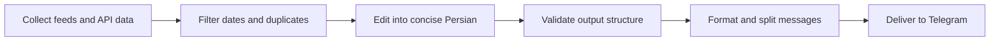

<div align="center">

# ☀️ Daily Telegram Brief

### Your morning, thoughtfully assembled.

Weather for the day. Headlines with sources. Something worth learning.<br>
Headline photos. Album covers. A track to press play on.

**A Persian daily digest, delivered straight to Telegram.**


[The experience](#the-daily-lineup) · [Quick start](#quick-start) · [Configuration](#make-it-yours) · [Automation](#put-it-on-autopilot) · [Member access](#member-only-personal-delivery) · [Development](#under-the-hood)

</div>

---

Daily Telegram Brief turns a handful of feeds and APIs into a readable morning routine. It runs locally or on GitHub Actions, uses PersianTools for Persian dates and text, and keeps private subscriptions in an encrypted file with the cryptography package. AI editing and audio downloads are optional.

## The daily lineup

| Section | What arrives in your chat |
| :--- | :--- |
| 🌤 **Your local forecast** | Current conditions and four upcoming three-hour forecast slots, displayed in your timezone. |
| 📰 **The news desk** | Up to two recent stories per category: world and society, business, arts and culture, science and technology. Each story gets its own card with the original source link, publication time, and feed-provided photo when available. |
| 🟠 **Hacker News** | Three recent submissions from the top-ranked list, with Persian editing when available, original links, discussion links, and source-reported scores/comment counts. |
| 💡 **Two things to learn** | Short learning cards with an explanation, a practical exercise, and a reference. Topics span engineering, philosophy, books, mythology, and the physics of human movement. |
| 🏆 **The final whistle** | Up to five final results each for soccer and basketball, covering games that started on the previous local calendar day. |
| 🎧 **Press play** | A track from a fresh Spotify release, or up to five entries from the US iTunes Store song chart, with listening links and each track's own cover art when available. |

Messages use compact sections and restrained formatting for reading on a phone. Long reports continue across messages without cutting away content. Telegram entities and UTF-16 offsets keep Persian text, emoji, bold spans, and code aligned.

### Pictures that belong to the story

News photos come from the story's RSS media metadata: image content, thumbnails, or image enclosures. Spotify cards use the selected album's cover; iTunes cards use the artwork attached to that specific chart entry. The model never chooses or invents image URLs.

Each story and track is sent as a separate photo card with its text as the caption. Telegram fetches the publisher-hosted image directly, so photos require no new dependency or API key and work even when audio downloads are disabled. At delivery time, recognized BBC thumbnail URLs request a 1,024-pixel-wide rendition of the same asset, and Apple artwork URLs request a 1,000 × 1,000 rendition. Spotify uses the largest declared album image. Unknown hosts and already larger images are left unchanged. This also improves images referenced by existing cached reports; it does not manufacture detail when the publisher has no larger original.

Captions are split conservatively at 1,024 UTF-16 units. Any remaining text follows in messages with its formatting intact. If Telegram explicitly rejects a larger rendition, the original source URL is tried. If no image can be sent, the complete text and source/listening link are sent instead. Ambiguous network failures do not trigger a second photo request, and blocked recipients are skipped immediately. Photo failure alone does not fail the report when the text fallback succeeds; a subsequent text-delivery failure still does. Preview mode prints image URLs without sending photos.

Images must be publicly reachable by Telegram and satisfy its [photo requirements](https://core.telegram.org/bots/api#sendphoto). The bot does not fetch article pages, search for substitute pictures, or generate posters.

### A window into Hacker News

The [official Hacker News API](https://github.com/HackerNews/API) adds a separate section alongside the existing BBC categories. It needs no API key. Each run considers at most 25 entries from `topstories`, fetches item metadata in batches of five, and selects up to three valid recent story submissions by keyword relevance, with API ranking as the tie-breaker. Jobs, comments, deleted/dead items, malformed records, duplicate titles/links, and submissions outside `NEWS_MAX_AGE_HOURS` are excluded. Links already selected by the BBC collector are omitted from this section too; filtering can leave fewer than the requested count.

Cards retain the original article link and HN discussion link, with score/comment counts when the API supplies valid values. The timestamp is explicitly labeled as the **HN submission time**, not the original article's publication time: a newly shared article may itself be older. HN is a community link aggregator, and ranking is not independent verification of a claim.

External links usually supply only a title. Editing is limited to that title and any text attached to the HN post; the bot does not fetch or summarize unseen article content or comments. Cards state this limitation. Original text remains available when Persian editing fails. The API provides no article image field, so these cards are text-only rather than borrowing unrelated pictures. The shared report snapshot includes the section for both requests and daily subscriber delivery. An API failure omits this section while the rest of the digest continues.

### Five recent releases, every daily report

An additional **five recent releases** section selects songs with a valid release timestamp in the last 30 days from the US iTunes top-100 feed. Each card includes the artist, release date, cover art, and listening link. It works without Spotify credentials and is included in the saved member report.

Existing music recommendations remain included. Tracks already featured in that report are excluded from the additional selection, and duplicate titles/artists and links are filtered. A date-based rotation changes the group daily when the candidate pool is stable. The source is a chart-filtered selection, not a complete catalog of all newly released music. No permanent listening history is stored, so changing source pools can cause repeats across days. If fewer than five valid recent tracks are available, only available entries are shown; old or undated tracks are never presented as new.

## Persian ecosystem integrations

The supplied resource lists were reviewed on **2026-11-07**. They are discovery catalogs, not interchangeable APIs or a promise that every linked service is free. In particular, the API catalog separates free, freemium, paid, and unknown-price services and notes that access from GitHub runners can differ from access inside Iran.

| Resource list | Relevant findings and decision |
| :--- | :--- |
| [fffaraz/awesome-persian](https://github.com/fffaraz/awesome-persian) | Archived list of date, font, and language tools. Date localization is useful; browser-only fonts and UI frameworks do not control Telegram's native message font. |
| [mohebifar/made-in-iran](https://github.com/mohebifar/made-in-iran) | Lists PersianTools and Ganjoor projects. Use maintained Python utilities and the public poetry API; do not install unrelated application frameworks. |
| [rastikerdar/awesome-persian](https://github.com/rastikerdar/awesome-persian) | Archived list with PersianTools, jdatetime, Khayyam, and Hazm. PersianTools covers this bot's date/character needs; multiple calendar libraries and a full NLP toolkit are unnecessary. |
| [Hameds/APIs-made-in-Iran](https://github.com/Hameds/APIs-made-in-Iran) | Supplies the calendar and Ganjoor discovery links. Public no-key reads were tested. Paid news APIs, limited free trials, financial/trading APIs, and unrelated payment or SMS services are not integrated. |

### What the bot uses

- **[PersianTools](https://github.com/majiidd/persiantools), MIT:** `persiantools==6.2.0` adds a Jalali date alongside the Gregorian date in report headers. Prose fields normalize Arabic letter variants to Persian characters. URLs, code, and source image identifiers are not passed through that normalization. This is not a spell checker or a factual verifier.
- **[holidayapi.ir](https://holidayapi.ir):** an optional calendar card shows the local date, provider-reported holiday status, and up to four distinct event descriptions. The provider attributes its data to time.ir. A malformed response or timeout preserves the locally calculated date and displays an availability message; it never invents a holiday status.
- **[Ganjoor](https://github.com/ganjoor/GanjoorService):** an optional **daily Hafez fal** card presents the full original ghazal, its title, local date, and Ganjoor link. A deterministic permutation of the 495 numbered ghazals keeps the choice fixed within the configured local day and changes it after midnight; the cycle repeats after 495 days. The documented page-by-URL API retrieves that exact poem, and an unexpected source path is rejected. Unexpected author/source paths, incomplete couplets, and oversized responses are rejected. A separate explanation uses the source's AI-generated literary summary when available, explicitly attributed to Ganjoor and labeled as AI-generated. Otherwise Groq may produce a labeled reading based only on the returned ghazal. If both are unavailable, the card states that the explanation is unavailable while preserving the poem. If unavailable, the card is omitted.

The third-party library license applies to PersianTools code; it does not establish licensing or uptime guarantees for remote providers or their data. No service source code or poem database is copied into the repository. The fal is presented as a literary tradition for reflection; no personal prediction or AI-generated fortune is fabricated. Network checks succeeded from the development environment; GitHub-runner reachability remains provider-dependent.

Both network features use one request attempt and an eight-second timeout. They run during report generation and are included in the shared report snapshot, so personal requests do not call these APIs again. Neither integration needs a new key or sends Telegram user identifiers to providers.

| Actions variable / environment setting | Default | Effect |
| :--- | :--- | :--- |
| `ENABLE_PERSIAN_CALENDAR` | `true` | Set `false` to omit the calendar card and its network request. |
| `ENABLE_PERSIAN_POETRY` | `true` | Set `false` to omit the daily Hafez fal and its network request. |

The daily generation and member workflows install the pinned core requirements; install them locally with `python -m pip install -r requirements.txt` before running the bot or tests. The remaining music sources are unchanged: no suitable documented, free Persian new-release music feed was established from these four catalogs.

### Free APIs catalog review

[Free APIs](https://free-apis.github.io/#/browse) was inspected in its JavaScript browse UI on **2026-11-07**, focusing on weather and music entries. Its [website source](https://github.com/Free-APIs/Free-APIs.github.io) is a directory application, not a replacement service backend. Each candidate still requires a check against its own documentation and current access rules.

- **Ganjoor** is listed in the music-related search results. Its public poem/page reads were tested directly without a key or OAuth, and the existing integration now supplies the daily Hafez fal. Directory-wide authentication badges are not treated as definitive endpoint-level requirements.
- **Open-Meteo** is a relevant no-key weather candidate. The [official terms](https://open-meteo.com/en/terms) limit the free hosted API to non-commercial use and impose request limits; it is not silently enabled as a universally free replacement for OpenWeather.
- **Deezer, Jamendo, Discogs, and Genius** appear among music-related entries. Their catalog listing alone does not establish anonymous access, free production usage, Persian coverage, or a reliable recent-release feed. No new adapter for these providers was enabled in this change.

The poem is arranged as separated couplets with a distinct title, date, quotation boundary, explanation heading, and source footer. The daily fal is included in the normal report and the shared member snapshot. It replaces the earlier single-couplet card, so reports do not duplicate both sections. A failed source request omits the fal while the remaining report continues. Original ghazals can span multiple Telegram messages using the existing lossless text splitter.

## Daily English vocabulary review

The owner's supplied table is preserved verbatim in [`data/vocabulary_source.tsv`](data/vocabulary_source.tsv). All **474 rows** are imported into [`data/vocabulary.json`](data/vocabulary.json), which is the runtime word bank. The original row IDs, words/phrases, Persian translations, English definitions, synonyms/equivalents, and grammatical categories are retained. `<br>` placeholders become missing values in JSON; they are never printed as HTML.

Each entry follows a dictionary-style structure: `word`, `translation`, `results` (definition, part of speech, synonyms, examples), `pronunciation`, `syllables`, and `frequency`. The last three fields are `null` when the supplied source contains no value. Missing examples are empty lists. No pronunciation, syllable count, or frequency score is invented. If you later add known examples, IPA (`pronunciation.all`), syllables, or a frequency value to JSON, the renderer can display them. Frequency is shown only as your recorded value, without claiming an unprovided measurement scale.

By default, the report adds **five review cards per day**, stable within the configured local day and rotating through case-insensitively distinct word/phrase labels. The cards contain separated Persian meaning, English definition, grammatical category, and synonym/equivalent sections, plus a short active-recall exercise. This is a shared daily rotation; it does not track individual mastery or implement a personalized spaced-repetition schedule. The source table may contain approximations or incomplete fields, and its meanings are not silently rewritten by a model.

Optional [Free Dictionary API](https://dictionaryapi.dev/) enrichment looks up only the selected single words, with one request attempt and a five-second timeout each. It can supply IPA and a pronunciation-audio link. Example sentences are attached only when the dictionary definition has sufficient lexical overlap with the user's definition; this is a conservative heuristic, not a guarantee of semantic equivalence. Phrases and collocations are not queried as single words. Dictionary metadata never replaces your translation or definition, and missing/failed enrichment leaves the offline learning card available.

The word bank is stored locally in the repository; only an individual selected word is sent to the dictionary provider. No paid dictionary subscription or new API key is needed. Personal member reports reuse the generated snapshot and do not repeat dictionary lookups.

| Actions variable / environment setting | Default | Effect |
| :--- | :--- | :--- |
| `ENABLE_VOCABULARY` | `true` | Set `false` to omit the vocabulary section. |
| `VOCABULARY_PER_DAY` | `5` | Review cards per report, from 1 to 8. |
| `ENABLE_VOCABULARY_DICTIONARY` | `true` | Set `false` for fully offline word cards with no dictionary requests. |

To update the bank, edit `data/vocabulary.json`; the TSV is the untouched source archive and is not automatically reimported. User-supplied lexical data is not automatically assigned the license of an unrelated API or library.

## An editorial workflow with boundaries



**Sources stay attached.** The main news desk uses four BBC RSS sections, complemented by Hacker News community submissions. BBC headlines must have a valid publication date and URL; HN entries must have a valid submission timestamp. By default, entries older than 36 hours, dates more than five minutes into the future, and duplicate titles or links within each collector are excluded. BBC categories are ordered by recency; Hacker News prioritizes configured interests and preserves API rank for ties. BBC remains the main news desk's publisher; HN submissions may link to various third-party sources.

**The model has a narrow job.** Groq rewrites titles and short summaries into Persian. The rules in [`src/prompts.py`](src/prompts.py) call for neutral language, preserved attribution and uncertainty, and no invented facts, quotations, statistics, or instructions taken from source text. The application adds categories, source names, timestamps, original URLs, and source-provided image URLs itself.

**Fallbacks are explicit.** Model responses must be JSON with known record IDs and nonempty fields within length limits. Truncated responses and invalid structures are rejected; duplicate records are discarded. If a usable rewrite is unavailable, the original source text appears with a clear label. It may be in English.

**Learning starts with a reference.** The educational section draws from 12 maintained seed notes in [`src/insights.py`](src/insights.py). Two notes rotate each day on a six-day cycle. AI can rewrite these notes; the original notes remain available as a fallback. To expand the collection, add a concise note, exercise, and suitable reference first.

> **Accuracy has limits.** Validation checks structure, not factual truth. News summaries use RSS titles and descriptions; the bot does not fetch full articles or independently verify reporting. Source links help readers inspect the original, but do not guarantee a correct translation or replace comparison across publishers. Learning cards are general educational material, not discoveries from today's news.

## Quick start

### 1. Set up the project

Use **Python 3.11 or newer** with IANA timezone data available. If your system does not provide that data, install the `tzdata` package.

```bash
git clone https://github.com/salman0H/telegram_daily_bot.git
cd telegram_daily_bot

python3 -m venv .venv
source .venv/bin/activate
python -m pip install -r requirements.txt

cp .env.example .env
```

The core requirements pin `persiantools==6.2.0` for Jalali dates and Persian character normalization. The commands above use a POSIX shell.

### 2. Add your settings

Edit `.env`, then export its values into your shell:

```bash
set -a
source .env
set +a
```

The bot reads environment variables; it does **not** load `.env` automatically. The example file uses shell-compatible assignments, and local `.env` files are ignored by Git.

For delivery, set `TELEGRAM_BOT_TOKEN` and at least one destination: `TELEGRAM_CHANNEL_ID` or `TELEGRAM_USER_ID`. Other service credentials enable their corresponding features.

### 3. Preview, then deliver

```bash
# Fetch data and print the report without sending Telegram messages.
python -m src.main --dry-run

# Deliver the report to the configured chat or channel.
python -m src.main
```

A preview needs no Telegram credentials and never downloads audio. It still makes network requests to public sources and, when credentials are configured, to Groq and optional services. Use the test suite for an entirely offline check.

## Make it yours

### Credentials

For GitHub Actions, add these under **Settings → Secrets and variables → Actions → Secrets**. Locally, export the same names as environment variables.

| Variable | Purpose | Required? |
| :--- | :--- | :--- |
| `TELEGRAM_BOT_TOKEN` | Bot token from [BotFather](https://t.me/BotFather). | For delivery. |
| `TELEGRAM_CHANNEL_ID` | Channel destination, such as `@channel` or a numeric `-100…` ID. Takes priority over the user destination. | Set at least one destination. |
| `TELEGRAM_USER_ID` | Personal chat destination when no channel is configured. | Set at least one destination. |
| `GROQ_API_KEY` | Persian editing through Groq. | Optional; source text and seed notes are the fallback. |
| `OPENWEATHER_API_KEY` | Current weather and forecasts from OpenWeather. | Optional; weather is omitted without it. |
| `SPOTIFY_CLIENT_ID` | Spotify application client ID. | Optional; requires the matching secret. |
| `SPOTIFY_CLIENT_SECRET` | Spotify application client secret. | Optional; requires the matching ID. |
| `SPORTRADAR_SOCCER_API_KEY` | Soccer v4 trial results. | Optional. |
| `SPORTRADAR_BASKETBALL_API_KEY` | Global Basketball v2 trial results. | Optional. |

Give the bot permission to post in your channel. For personal delivery, start a conversation with the bot first. Empty values and the strings `null` and `none` are treated as unset. Keep credentials out of source code and committed files.

### Preferences

Set these as environment variables locally or in the repository's Actions **Variables** tab.

| Variable | Default | What it controls |
| :--- | :--- | :--- |
| `BOT_ENABLED` | `true` | Set to `false` to pause daily generation/delivery and member request processing. |
| `TIMEZONE` | `Asia/Tehran` | IANA timezone for display and sports calendar boundaries. |
| `CITY_NAME` | Mashhad, displayed in Persian | Weather section label; changing it does not change coordinates. |
| `WEATHER_LAT` | `36.2605` | Latitude, from -90 to 90. |
| `WEATHER_LON` | `59.6168` | Longitude, from -180 to 180. |
| `NEWS_MAX_AGE_HOURS` | `36` | Maximum news age, from 1 to 168 hours. |
| `NEWS_PER_CATEGORY` | `2` | Stories per category, from 1 to 3. |
| `ENABLE_HACKER_NEWS` | `true` | Set `false` to omit Hacker News and its requests. |
| `HACKER_NEWS_PER_DAY` | `3` | Hacker News submissions per report, from 1 to 5; subject to freshness and availability. |
| `GROQ_MODELS` | `openai/gpt-oss-120b,llama-3.3-70b-versatile` | Comma-separated models in preference order. |
| `ENABLE_AUDIO_DOWNLOAD` | `false` | Set to `true` to enable optional audio downloads. |

An API failure, truncated completion, or invalid top-level response moves editing to the next configured model. Individual invalid records fall back to their original content. Check model access and quotas in the [Groq documentation](https://console.groq.com/docs/models).

<details>
<summary><strong>🎵 Add optional audio downloads</strong></summary>

Music links work without a downloader. To enable audio delivery, install `ffmpeg` through your system package manager, then run:

```bash
python -m pip install -r requirements-audio.txt
export ENABLE_AUDIO_DOWNLOAD=true
```

Both Spotify credentials must be configured, and Spotify must return a valid track. The bot searches YouTube for that artist and title, then attempts an MP3 download with these bounds:

| Guardrail | Limit |
| :--- | :--- |
| Download process timeout | 180 seconds |
| Track duration filter | Up to 10 minutes |
| Final file size | Up to 45 MiB |
| File lifecycle | Temporary directory, cleaned up after use |

The listening link is sent before the optional download. A download or audio delivery failure leaves that link available and does not, by itself, fail the report.

Search results may differ from the intended recording. YouTube access can depend on runner restrictions and extractor requirements. The optional downloader dependency uses a version range rather than a lockfile; keep it current as upstream services change.

</details>

## Put it on autopilot

The workflow in [`.github/workflows/daily_report.yml`](.github/workflows/daily_report.yml) handles checks and delivery.

| Trigger | Behavior |
| :--- | :--- |
| Push or pull request | Run offline tests on Python 3.11 and 3.14. A push to the default branch also refreshes the public report snapshot in preview mode, without channel delivery. |
| Daily schedule | Request execution at **03:30 UTC / 07:00 Tehran**, then run checks, generate, and deliver. Actual delivery depends on GitHub starting the job. |
| Manual workflow run | Run checks, then deliver; select `dry_run` to print a preview in Actions logs instead. |
| Authenticated `repository_dispatch` | `daily-report` generates and delivers; `member-requests` runs the personal responder. Intended for an optional external scheduler. |

To run manually, open **Actions → Daily Telegram Report Bot → Run workflow**.

The daily workflow has read-only repository and Actions permissions and caps the report job at 12 minutes. It uploads a content-only `daily-report` artifact with two-day retention for personal member requests. Both delivery jobs share one concurrency group so subscriber state has only one writer and Telegram has only one update consumer. Audio dependencies are installed only when downloads are enabled and preview mode is off. Preview runs never subscribe users or send private broadcasts.

The cron expression is `30 3 * * *`. Changing `TIMEZONE` changes report interpretation and display, not the cron schedule. **GitHub Actions does not guarantee a 07:00 delivery.** The repository's run history on November 7–9, 2026 showed daily jobs starting around 14:05–15:28 Tehran and member jobs separated by hours despite their five-minute cron. Increasing polling frequency or shifting the cron cannot guarantee a fix. Generation logs print the actual Tehran start time for comparison.

### Optional external scheduling

An external scheduler can bypass GitHub's delayed `schedule` trigger by making an authenticated `POST` to `https://api.github.com/repos/OWNER/REPO/dispatches`. Use JSON `{"event_type":"daily-report"}` at **03:30 UTC** and `{"event_type":"member-requests"}` at the desired polling interval. Follow GitHub's [repository dispatch authentication requirements](https://docs.github.com/en/rest/repos/repos#create-a-repository-dispatch-event); store its credential only in the scheduler's secret storage, never in this repository or Telegram messages.

After testing the external trigger, set Actions variable `DAILY_EXTERNAL_SCHEDULER=true` to skip native scheduled daily delivery and avoid duplicate channel reports. `MEMBER_EXTERNAL_SCHEDULER=true` similarly skips native scheduled member jobs. Manual runs and dispatch events remain available. No external scheduler is provisioned by this repository, and these switches default to off. Dispatch still depends on available GitHub runners; strict delivery times and immediate chat responses require a persistent worker or webhook host.

## Member-only personal delivery

Anyone can open the bot privately and send `/start` to activate daily delivery and receive the latest prepared digest. `/report` or `/run` requests one report without activating a subscription; `/stop` or `/unsubscribe` cancels automatic delivery. `/start` or `/subscribe` enables it again. Access requires current membership in **[@sentencedIntoMusic](https://t.me/sentencedIntoMusic)** by default.

| User state | Bot response |
| :--- | :--- |
| Current channel member, administrator, or owner | Send the latest report to that user's private chat, including news photos and music artwork. |
| Not a member or removed from the channel | Show **Join channel** and **I joined — check again** buttons. |
| Membership cannot be checked | Explain the temporary failure; send no report. |
| No fresh snapshot is available | Explain that the report is not ready; do not generate replacement content. |

Membership is checked live on every report request and before every automatic delivery, including the recheck button. A restricted user qualifies only when Telegram explicitly reports `is_member: true`. Personal replies use an isolated destination context, so a configured channel destination cannot redirect a user's report. Group requests are ignored. `/stop` works without channel membership. A nonmember who starts the bot can finish subscribing through the join/recheck button; a one-off `/report` recheck does not subscribe them.

### Daily delivery and private state

Subscribers receive the current local day's prepared digest once it is available, at or after 07:00 in `TIMEZONE`. The daily job broadcasts after generating the report, and subsequent member workers continue any remaining recipients. Yesterday's snapshot is never broadcast as today's digest. Successful personal requests also mark that day's report as received for existing subscribers, avoiding another automatic copy. An explicit later `/report` can still retrieve it again.

Each run attempts at most ten reports within its time budget. Membership failures or leaving the channel prevent delivery without repeated automatic join prompts. Blocking the bot removes that subscription and does not stop other users. Delivery is marked complete only after all report cards succeed; interrupted reports may repeat some cards on a later attempt. A crash or artifact upload failure can also cause repeats because Telegram delivery and state persistence are not transactional.

The `subscribers-v1` Actions artifact contains only authenticated Fernet ciphertext, never plain chat IDs or the bot token. It is separate from the public `daily-report` snapshot. By default, the encryption key is derived from the existing bot token with domain separation, so no new secret is required. For token rotation, configure a stable optional `SUBSCRIBER_STATE_KEY` **before the first subscription** using a generated Fernet key. Keep that key unchanged; adding/changing it after subscriptions exist requires migrating the old encrypted state. A decryption failure stops processing and never resets the list silently.

State changes are checkpointed locally and uploaded at the end of the serialized job. Unchanged state does not create another artifact. Retention is requested for 90 days, subject to repository policy; removing/expiring all state artifacts loses the subscriber list. Keep an encrypted backup for longer pauses. Up to 10,000 subscriber records can be stored, but the GitHub worker's runtime is intended for small audiences. User IDs, subscriber artifacts, and encryption keys must never be committed. There is no migration of past Telegram conversations: **existing users must send `/start` once after deploying this update**. Telegram bots cannot enumerate everyone who previously started them.

### Set up the channel

1. **Make the bot an administrator** in `@sentencedIntoMusic`. Simply adding it as a member is insufficient for reliable checks of other users. Telegram documents this requirement for [getChatMember](https://core.telegram.org/bots/api#getchatmember).
2. Keep the existing `TELEGRAM_BOT_TOKEN` repository secret. The personal responder needs no Groq, Spotify, weather, or sports credentials.
3. Confirm that the **Member Report Requests** workflow is enabled on the repository's default branch.
4. Open the bot privately and send `/start`. Existing members receive the prepared digest; others get the join prompt. Response time depends on the next scheduled worker run.

The first push of this feature to the default branch builds a snapshot after the tests pass. You can also refresh it through **Daily Telegram Report Bot → Run workflow → `dry_run: true`**, which makes source requests and updates the snapshot without posting to Telegram. Regular daily generation remains scheduled for **07:00 Tehran**.

### Membership settings

| Setting | Default | Where to configure |
| :--- | :--- | :--- |
| `MEMBERSHIP_CHANNEL_ID` | `@sentencedIntoMusic` | Actions variable, or environment variable locally. Independent of the daily delivery destination. |
| `CHANNEL_JOIN_URL` | Derived from the public channel username | Optional Actions variable or secret. For a private channel, use its numeric ID above and provide its HTTPS Telegram invite link here; use a secret for private invites. |
| `MEMBER_REQUESTS_ENABLED` | Enabled unless set to `false` | Actions variable. Set to `false` to pause request processing while keeping the daily report running. |
| `DAILY_SUBSCRIPTIONS_ENABLED` | `true` | Actions variable. Set `false` to pause automatic private broadcasts; one-off requests remain available. |
| `SUBSCRIBER_STATE_KEY` | Derived from bot token | Optional Actions **secret** containing a stable Fernet key for encrypted subscriber state. |

The public channel's join button defaults to `https://t.me/sentencedIntoMusic`. Channel owners can change the membership requirement without changing the bot's daily posting destination.

### How it works on GitHub Actions

The [member request workflow](.github/workflows/member_requests.yml) requests a start every five minutes, at the explicit minute list `02, 07, 12, …, 57`. A run restores encrypted subscriptions, checks webhook status and the bot's channel admin status, and downloads the newest `daily-report` artifact from this repository's default branch. It first processes queued requests (including `/stop`), attempts pending daily deliveries, then listens for more requests within a total budget of up to 240 seconds. Long polls wait up to 20 seconds and can return as soon as updates arrive. The worker reserves time to finish delivery, attempts up to ten reports per invocation, and limits duplicate report delivery to one per user within that invocation. Membership is queried for incoming requests and subscribed recipients, not by enumerating channel members.

Only a validated snapshot no older than 36 hours is served. It contains report text, public image links, a generation timestamp, and a schema version; no recipient IDs or credentials are exported. On-demand reports reuse this content, including its original weather and news timestamps. They do not rerun the model or download audio files; listening links and artwork remain included.

Telegram keeps the update cursor: the worker confirms only the processed prefix using `getUpdates(offset=...)`. Requests beyond the batch or time limit remain pending for the next invocation. A delivery failure for one user does not trap the queue. If a process stops after delivery but before confirmation, a later run may repeat that request; multi-message delivery is not transactional.

**GitHub must actually start the worker.** The cron expression is a requested schedule, not an active listener. Keeping a started worker alive reduces idle gaps but cannot make GitHub start a missed or delayed job. If the run history contains only `workflow_dispatch` events, automatic starts have not occurred: confirm that the workflow is enabled on the default branch, inspect Actions run history, and use **Run workflow** as a temporary listener. Worker logs now include processed-update, membership-check, and report-attempt counts without user IDs.

**This is delayed, small-audience delivery.** GitHub's [scheduled workflows](https://docs.github.com/en/actions/reference/workflows-and-actions/events-that-trigger-workflows#schedule) may run late, so five minutes is a polling interval rather than a response-time guarantee. A backlog can take several runs, and Telegram retains pending updates for at most 24 hours. Use exactly one consumer for this bot token; an existing webhook is detected and left untouched. The workflow uses repository read permissions plus `actions: read` to retrieve the report artifact.

At this interval there are up to 288 worker runs per day. For private repositories, account for your plan's Actions allowance; see [GitHub Actions billing](https://docs.github.com/en/billing/concepts/product-billing/github-actions). For immediate responses or a larger audience, move request handling to a persistent worker or webhook service.

For a local, single-consumer check after exporting the environment:

```bash
# Build a snapshot without Telegram delivery.
python -m src.main --dry-run --export-report report-cache/daily-report.json

# Process a bounded batch of real private requests, checking channel membership.
python -m src.member_bot --report report-cache/daily-report.json --listen-seconds 240

# Persist subscriptions and also send today's digest to subscribed members.
python -m src.member_bot --report report-cache/daily-report.json \
  --state subscriber-cache/subscribers.enc --save-state subscriber-cache/subscribers.enc \
  --listen-seconds 240 --broadcast
```

The last two commands contact Telegram and reply to pending users. The command without state arguments is for one-off request handling and does not retain subscriptions. Pause the Actions responder first to prevent concurrent consumers; do not run both commands at once.

## Pause, resume, and blocked users

To pause the whole bot, open **Settings → Secrets and variables → Actions → Variables** and create or update:

```text
BOT_ENABLED=false
```

Both the daily report job and the member responder will skip new runs. Checks on code changes still run. To resume, set `BOT_ENABLED=true` or remove the variable. This applies to new jobs; cancel any running jobs in the Actions UI if you need delivery to stop immediately. For local runs, export `BOT_ENABLED=false`; both CLI entry points return without fetching data, consuming updates, or sending messages.

To pause **only personal requests**, keep `BOT_ENABLED` enabled and set `MEMBER_REQUESTS_ENABLED=false`. Daily channel delivery continues. Pending private requests are left unconfirmed while paused and may be processed after resuming, subject to Telegram's update retention.

Users can send `/stop` to cancel automatic daily delivery, or block the bot in Telegram. The command takes effect when the next worker processes it. If Telegram returns HTTP 403 for a delivery attempt, the recipient is treated as unavailable: remaining report messages are abandoned, the photo-to-text fallback is suppressed, their subscription is removed, and other users continue. Duplicate pending requests from that recipient are skipped within the same batch and confirmed, preventing the queue from getting stuck. These errors do not create a permanent local ban; after unblocking, the user can send `/start` again to rejoin and membership is rechecked.

An HTTP 403 from a membership check remains an API/access error and does not label a user as blocked. A forbidden daily posting destination stops further delivery and optional audio to that destination and still marks the daily job as failed so the owner can fix channel permissions.

## Under the hood

Independent collectors run with up to five workers. Editorial calls and delivery remain ordered. Source requests use timeouts and bounded retries for temporary network failures, HTTP 429, and server errors.

Telegram delivery has a separate policy: retry only after an explicit HTTP 429 response with a valid server delay of at most 30 seconds. An ambiguous network failure is reported without automatically resending, since the first request may already have reached Telegram.

```text
telegram_daily_bot/
├── .github/workflows/
│   ├── daily_report.yml              # Daily schedule, preview, snapshot export, and CI
│   └── member_requests.yml           # Five-minute membership-gated request batches
├── src/
│   ├── config.py                     # Environment settings and validation
│   ├── http_client.py                # Bounded requests, timeouts, and retries
│   ├── news.py                       # RSS stories, photos, freshness, and deduplication
│   ├── prompts.py                    # Editorial rules and JSON output contracts
│   ├── insights.py                   # Educational seed notes and references
│   ├── writer.py                     # Validated editing and source-paired news cards
│   ├── formatting.py                 # Telegram entities and UTF-16 message splitting
│   ├── media.py                      # Larger source-CDN renditions with original fallback
│   ├── persian.py                    # Jalali dates and Persian character normalization
│   ├── persian_content.py            # Optional calendar and sourced Hafez cards
│   ├── telegram_sender.py            # Text, photo cards, and audio delivery
│   ├── weather.py                    # Current conditions and local forecasts
│   ├── sports.py                     # Final scores and local calendar filtering
│   ├── song.py                       # Spotify/iTunes artwork and optional audio
│   ├── member_bot.py                 # Membership gate, join buttons, bounded request polling
│   ├── hacker_news.py                # Official HN API collection and attributed cards
│   ├── subscribers.py                # Encrypted subscriptions and last daily delivery date
│   ├── report_store.py               # Public snapshot schema, freshness, and size checks
│   └── main.py                       # Report orchestration, snapshot export, and CLI
├── tests/
│   ├── test_bot.py                   # Core offline regression tests
│   ├── test_images.py                # Image provenance and photo delivery tests
│   ├── test_membership.py            # Access control, routing, snapshots, and update cursors
│   ├── test_controls.py              # Global pause and blocked-recipient isolation
│   └── test_quality_and_polling.py    # Image renditions and late-arriving requests
├── .env.example                      # Configuration template
├── requirements.txt                  # Pinned PersianTools and cryptography dependencies
└── requirements-audio.txt            # Optional downloader dependency
```

### Check your changes

```bash
python -m compileall -q src tests
python -m unittest discover -s tests -v
```

Tests use controlled responses and require no internet access or real credentials. Coverage includes long Persian messages with emoji, entity offsets, Telegram rate limits, malformed model responses, original source links, stale and duplicate news, local sports dates, track selection, and failure isolation. Image tests also cover RSS media extraction, matching each cover to its track, caption overflow, photo-to-text fallback, and previews that never deliver media. Membership tests cover denied access, live rechecks, membership API failures, private recipient isolation, join buttons, snapshot freshness, startup admin/webhook checks, and acknowledgement of only processed updates. Control tests verify that pausing prevents API calls and that a blocked recipient cannot stop delivery to the next user. Quality and polling tests cover larger source URLs, fallback to the original image, no duplicate photo retries on ambiguous failures, and requests arriving after an initial empty poll.

Subscription tests cover encrypted persistence across workers, wrong-key rejection, opt-out before broadcasts, daily deduplication, stale report exclusion, blocked-recipient removal, recipient isolation, backlog limits, and independent one-off requests.

To change the editorial voice, edit `src/prompts.py`. To extend educational topics, update `src/insights.py`. To change news sources, update `FEEDS` in `src/news.py` and retain valid source attribution, URLs, and publication dates.

## When something goes wrong

| Situation | What to expect / what to check |
| :--- | :--- |
| Missing Telegram token or destination | Delivery stops before collection; exit code `2`. Preview still works. |
| A source or collector fails | Its error type is logged without credential-bearing URLs; other sections continue. |
| No valid recent news | A clear availability message appears instead of generated replacement stories. |
| A Telegram message fails | Later sections are still attempted; exit code `1` marks the workflow as failed. |
| A photo is missing or rejected | The full text is sent instead; confirm that the image URL is publicly accessible to Telegram. |
| Optional audio fails | A warning is logged; this alone does not fail the report. |
| HTTP 401 or membership/API HTTP 403 | Check credentials, service access, and channel administrator permissions. |
| Delivery HTTP 403 | Skip the unavailable recipient and continue with other users; a forbidden daily destination requires owner attention. |
| Membership check fails | Confirm that the bot is an administrator in `MEMBERSHIP_CHANNEL_ID`; access stays closed while verification is unavailable. |
| Member reports are delayed | Check **Member Report Requests**, Actions availability, and pending request volume. |
| Groq is unavailable or returns invalid output | A subsequent model or original-content fallback is used; check model settings and quota. |

### Operating boundaries

- **Encrypted subscription file.** Automatic private delivery persists user IDs and the last completed local report date in a separate encrypted Actions artifact. Public report content remains separate. `/report` is available independently of subscription and can return the same snapshot on a later run.
- **Delivery is partial by nature.** Several messages form a report; some may arrive before a later message fails.
- **Sports depend on coverage.** Available results reflect your Sportradar trial access and its data coverage. The old volleyball variable has been removed because no volleyball collector was implemented.
- **Images depend on their sources.** Some stories and tracks have no usable artwork. Publisher links may expire or block Telegram. A network timeout can leave photo delivery uncertain; the text fallback may repeat a caption that already arrived.
- **Music labels are specific.** The US iTunes Store chart is not a global Apple Music streaming chart. A Spotify new-release pick is not a claim about trending rank.
- **Learning repeats deliberately.** The seed catalog is finite; extend it with referenced notes when you want a longer rotation.

## Reference shelf

| Integration | Documentation |
| :--- | :--- |
| Telegram | [Bot API: messages, entities, and media](https://core.telegram.org/bots/api) |
| Hacker News | [Official API: ranked stories and item metadata](https://github.com/HackerNews/API) |
| Groq | [Models](https://console.groq.com/docs/models) · [Structured outputs and JSON mode](https://console.groq.com/docs/structured-outputs) |
| OpenWeather | [Three-hour forecast API](https://openweathermap.org/api/forecast5) |
| Sportradar | [Global Basketball event summaries](https://developer.sportradar.com/basketball/reference/global-basketball-sport-event-summary) |
| yt-dlp | [Installation and requirements](https://github.com/yt-dlp/yt-dlp#installation) |

### License

This repository currently has no standalone license file. The previous README's MIT claim was unsupported; no license is declared here.

---

<div align="center">

**A small daily ritual, powered by a small Python project.**

</div>

## Space, science, and your interests

NASA's [APOD API](https://github.com/nasa/apod-api) adds one selected astronomy image to the shared daily report. Set Actions secret `NASA_API_KEY` to your free NASA key; the fallback `DEMO_KEY` has shared, restrictive quotas. Set `ENABLE_NASA=false` to disable it. Image cards include the APOD selection date (not the photograph's capture date), source credit, and a grounded Persian explanation when Groq is available. If translation fails, the original explanation is explicitly labeled. Video days link to the source instead of pretending to be photographs. Missing or stale data omits the section.

The preview image is followed by the source's `hdurl` as a Telegram document, with a source button, for both channel and personal delivery. This avoids Telegram photo compression; it does not promise a raw camera file. Telegram must be able to fetch the document and accept its size/type. A rejected document falls back to the original download link. No substitute image or invented credit is generated. This first version uses APOD only; NASA Image Library search, discovery history, and interactive topic selection are not implemented.

`NEWS_KEYWORDS` is an optional comma-separated Actions variable. Defaults prioritize Iran, the Middle East, America, technology, Elon Musk, NVIDIA, artificial intelligence, and computers, including Persian equivalents. Matching titles and descriptions rank ahead of other recent BBC entries within each category; this is prioritization, not an exhaustive search of the web. Freshness limits remain in force. Hacker News now prioritizes the configured interests within its bounded candidate pool, retaining API rank for ties.

Additional sources reviewed: [Wikimedia APIs](https://www.mediawiki.org/wiki/Wikimedia_APIs) are suitable for encyclopedic background, rather than treating edits as breaking news. No Wikimedia adapter is enabled in this version. [Guardian Open Platform](https://open-platform.theguardian.com/access/) requires a key and distinguishes noncommercial developer access from commercial licensing. It is not enabled automatically or presented as an unrestricted free source.

### APOD outage recovery

If the NASA API fails or returns invalid/stale metadata, the collector reads the official NASA Science APOD landing page, follows its dated APOD article, and extracts the article's explanation, photographer credit, and original image link. It never selects the landing page's generic social-preview image. Selection dates are checked against the same two-day freshness window. If the page structure changes or an original image cannot be identified, the section is omitted rather than substituting an unrelated picture. This image fallback requires no API key. Video-only articles may remain unavailable during an API outage. Logs distinguish API failure, successful page fallback, and successful Telegram original-document delivery.

### Edit your news interests

The default interests now live in [`data/news_keywords.json`](data/news_keywords.json), in the `keywords` array. Add or remove strings, preserve valid JSON, and deploy your change. English terms matter because the current BBC/HN inputs are primarily English. The supplied list covers Iran, the Middle East, America, technology, Elon Musk, NVIDIA, AI, computers, programming, open source, and related topics. It is shared by all recipients rather than tracking individual user preferences.

Each distinct matching phrase adds one point; matching ignores case and checks word boundaries. Several related keywords can raise a story's score. BBC candidates are ordered by interest score, then publication time within each category. Hacker News examines at most 25 ranked entries and prefers matching submissions, retaining HN rank for ties. Freshness, validity, and deduplication checks still apply. This prioritizes available source candidates, not an exhaustive search; if there are too few matches, other valid recent stories fill the remaining slots.

Optional Actions variable `NEWS_KEYWORDS` (comma-separated) overrides the JSON list. Leave it empty or delete it to use the file. Invalid/missing JSON stops configuration with a clear error rather than silently ignoring your interests.
